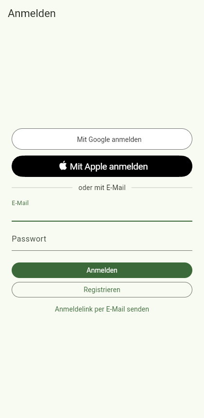
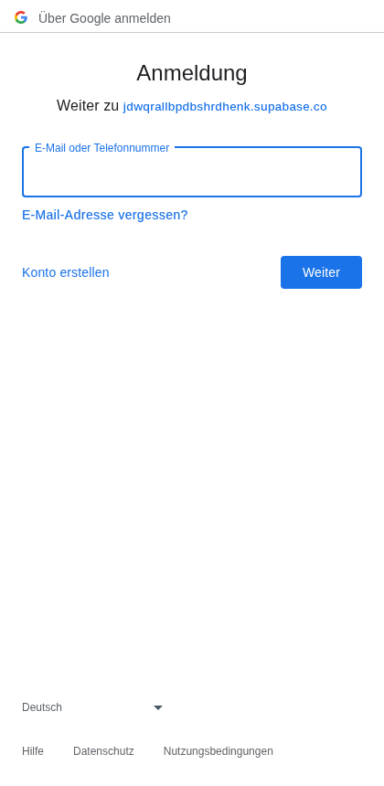
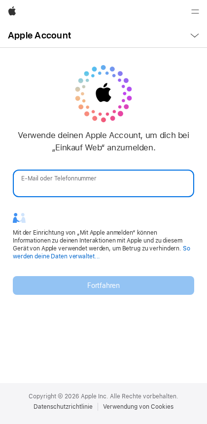
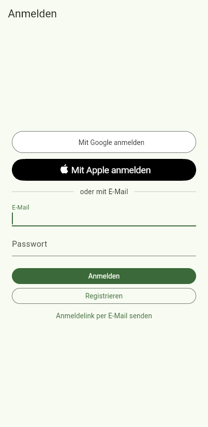

# Job 7: Vercel hosting, real auth config, API-only Supabase deploy

PR: https://github.com/trost-systems/family-groceries/pull/14

## What changed for Peter and Lea

- The web app is public at **https://family-groceries-pied.vercel.app**.
  Every push to `main` deploys it; branches get protected previews.
- "Mit Google anmelden" and "Mit Apple anmelden" are on in every build
  (`app/config/auth.json` has the real public client IDs). On the web both
  reach the providers' sign-in pages (screenshots below).
- Sign-in links, magic links and MCP connections land on the web app. The
  hosted project's Site URL was `http://localhost:3000` before.
- Invite links from the phone apps point at the web app's `/join/CODE`.

## What was built, where

| Piece | Files |
| --- | --- |
| Auth config | `app/config/auth.json`, `app/ios/Flutter/Auth.xcconfig` (`auth_config_test.dart` checks they agree) |
| Vercel build | `vercel.json`, `scripts/vercel.sh` (install: CI-pinned Flutter shallow clone into `node_modules/.flutter`, the folder Vercel caches; build: base href `/`, `SUPABASE_URL`/`SUPABASE_PUBLISHABLE_KEY` from Vercel env, refuses non-publishable keys) |
| Local proof of the Vercel build | `scripts/vercel-local.sh` (fresh clone, Amazon Linux 2023, root, cached `node_modules` volume) |
| Deployment check | `e2e/web-smoke.mjs` (routes, cache headers, Google and Apple sign-in pages; share links for protected previews) |
| Function bundling | `supabase/config.toml` `import_map` per function; `supabase/deploy/config_test.ts` guards it |
| API-only migrations | `supabase/deploy/migrate.ts` (+ tests) |
| Hosted auth URLs | `supabase/deploy/auth_urls.ts` (+ tests) |
| Deploy workflow | `.github/workflows/supabase-deploy.yml`: migrations via Management API, `functions deploy --use-api`, smoke test, red on missing credentials |
| Removed | `.github/workflows/web-deploy.yml` (GitHub Pages), `WEB_BASE_PATH` |
| Docs | `docs/DECISIONS.md` (7.1 to 7.9), `docs/NEEDS_PETER.md` (status, sections 1 to 3, "Job 7"), verify map `features/web-hosting.md` |

## How to verify

```bash
(cd e2e && npm ci) && node e2e/web-smoke.mjs https://family-groceries-pied.vercel.app /tmp/smoke
scripts/vercel-local.sh /tmp/fg-vercel-out          # the Vercel build, locally
(cd supabase/deploy && deno test --allow-read)      # deploy tooling
set -a; source ~/groceries-ops/env; set +a; export SUPABASE_PROJECT_REF=jdwqrallbpdbshrdhenk
deno run --allow-read --allow-env --allow-net --config supabase/deploy/deno.json supabase/deploy/migrate.ts --dry-run
supabase functions deploy --use-api --project-ref "$SUPABASE_PROJECT_REF"
```

## Results

- `scripts/verify.sh` (local, 2026-10-23 17:15): all checks passed.
  gitleaks clean, pgTAP 390/390, `db lint` clean, Deno tests 230 (functions)
  + 3 (classifier) + 13 (deploy tooling) + 20 (fg CLI), Flutter 156/156,
  web build, Playwright 48/48.
- CI on PR #14: green (`ci-ok`). The first run had one e2e failure in
  `stores.spec.ts:105` (a snackbar, not in this diff); it passed on rerun and
  is reported to 02b on the board.
- Vercel preview (share link): `node e2e/web-smoke.mjs` all `ok`. SPA routes
  and cache headers are as configured, Google reaches `accounts.google.com`
  with the web client ID, Apple reaches `appleid.apple.com` with the
  Services ID.
- `scripts/vercel-local.sh`: cold install 50 s, cached 20 s, build 35 s,
  output 42 MB. On Vercel: build "Completed in /vercel/output [2m]".
- `supabase functions deploy --use-api`: health, mcp and voice deployed. It
  failed before with "Relative import path @modelcontextprotocol/server".
  The "Supabase deploy" workflow, dispatched on this branch, ran in 16 s with
  real work: migrations up to date, three functions deployed, smoke test ok.
  With the credentials missing, the check step exits 1 with "Nothing was
  deployed" (run locally).
- `migrate.ts` apply path against the local database: an applied migration
  shows in `supabase migration list`; a failing one leaves neither its table
  nor its history row.
- Hosted auth after `auth_urls.ts` (read back through the API): Site URL
  `https://family-groceries-pied.vercel.app`, redirects as in
  NEEDS_PETER section 2, OAuth server enabled at `/oauth/consent`. Rerunning
  reports "already up to date".

- Production after the merge (a56f5c4, 2026-10-23 17:25): Vercel deploy
  succeeded, "Supabase deploy" on main green in 22 s, and
  `node e2e/web-smoke.mjs https://family-groceries-pied.vercel.app` all `ok`
  (same checks as the preview).
- MCP OAuth on production: a client registered by DCR and sent to
  `/auth/v1/oauth/authorize` gets `302` to
  `https://family-groceries-pied.vercel.app/oauth/consent?authorization_id=...`.
  The test client was deleted afterwards (admin API `204`, then `404`).
- Not checked: whether Vercel's build cache keeps the 1.55 GB SDK and pub
  cache (DECISIONS 7.2). Without the cache, a build pays about 30 s more.

Production screenshots:





Screenshots (Vercel preview of the PR branch):




## Still open (needs Peter, details in docs/NEEDS_PETER.md)

- Android OAuth client for the release keystore's SHA-1 (section 4, step 7).
- Apple client secret renewal by 2027-04-21 (section 4, step 13).
- Xcode capability check and a real sign-in on the phones (section 4, steps
  16 and 18). The automated checks stop at the providers' sign-in pages
  because a real round trip needs a Google or Apple account.
- Optional: delete the unused repo secret `SUPABASE_DB_PASSWORD`.
